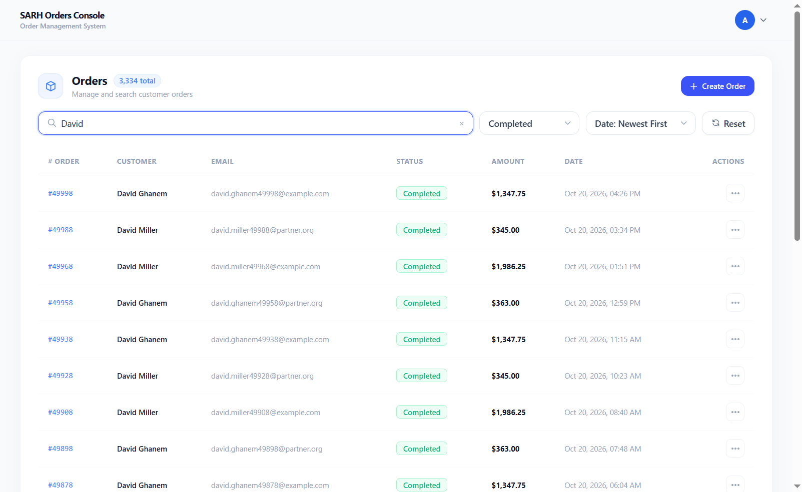
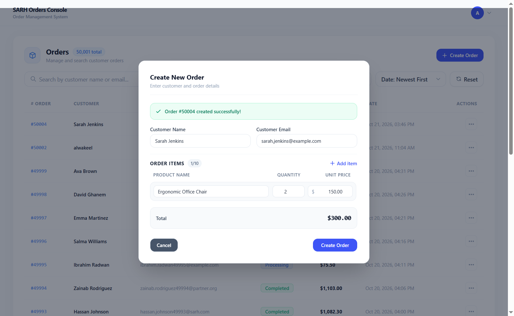
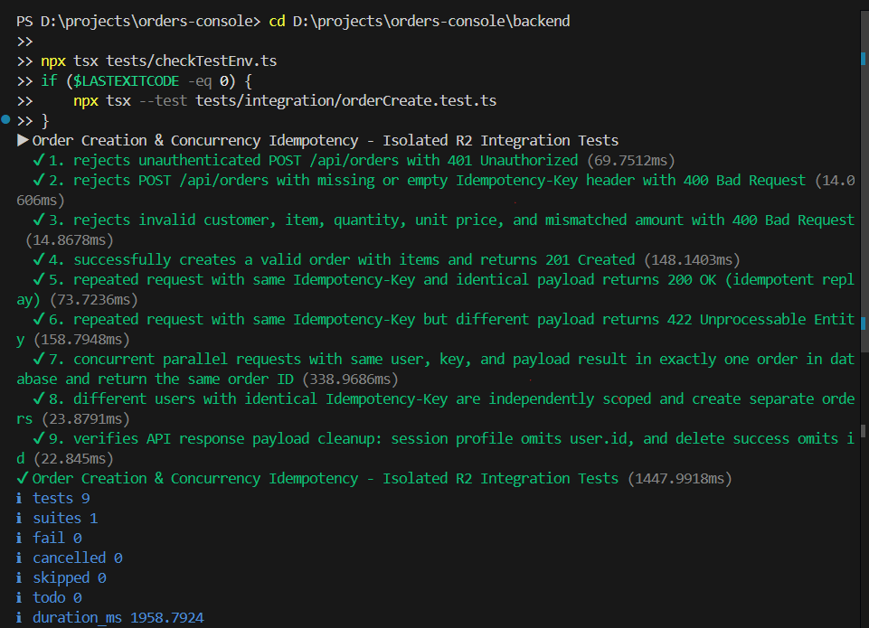

# SARH Orders Console — Order Management System

A full-stack order management console built for the SARH Business Solutions technical assessment. The application includes HttpOnly cookie authentication, role-based access control, server-side order search and pagination across a 50,000-order dataset, stale-response protection during rapid filtering, and database-enforced idempotent order creation.

## 1. Technology Stack

- **Frontend:** React 18, Vite, TypeScript, Native Fetch API, Tailwind CSS.
- **Backend:** Node.js, Express, TypeScript, Prisma ORM.
- **Database:** PostgreSQL 17 with the `pg_trgm` extension.
- **Testing:** Node.js Native Test Runner (`node:test`) and `tsx`.

## 2. Key Features

- **Server-side pagination (R1):** Uses a default page size of 20 and validates a maximum page size of 50.
- **Case-insensitive substring search (R1):** Searches customer names and email addresses, using PostgreSQL trigram GIN indexes (`pg_trgm`).
- **Filtering and sorting (R1):** Filters by order status and sorts by creation time or amount in ascending or descending order.
- **Stale-response protection (R1):** A sequence counter held in React `useRef` prevents older asynchronous responses from overwriting newer search results.
- **Idempotent order creation (R2):** A PostgreSQL composite unique constraint on `(user_id, idempotency_key)`, SHA-256 payload verification, and a Prisma transaction prevent duplicate orders under concurrent requests. Identical retries return the existing order with HTTP `200`; reuse of a key with a different payload returns HTTP `422`.
- **Role-based access control:** Both `ADMIN` and `AGENT` users can access permitted order operations. Deleting orders is restricted to administrators; agent delete requests are rejected with HTTP `403`.
- **Cookie-based authentication:** JWTs are stored in `HttpOnly` and `SameSite=Strict` cookies. Origin validation is used on state-changing requests to help protect against CSRF.

## 3. Project Structure

```text
orders-console/
├── .env.example
├── .gitignore
├── DECISIONS.md
├── README.md
├── package.json
├── evidence/
│   ├── 01-r1-rapid-filtering.png
│   ├── 02-r2-order-creation.png
│   └── 03-r2-concurrency-proof.png
├── backend/
│   ├── package.json
│   ├── tsconfig.json
│   ├── prisma/
│   │   ├── schema.prisma
│   │   ├── seed.ts
│   │   └── migrations/
│   │       └── 20261020133254_init/
│   │           └── migration.sql
│   ├── src/
│   │   ├── config.ts
│   │   ├── db.ts
│   │   ├── index.ts
│   │   ├── testDbGuard.ts
│   │   ├── middleware/
│   │   │   ├── auth.ts
│   │   │   └── originGuard.ts
│   │   ├── routes/
│   │   │   ├── auth.routes.ts
│   │   │   └── order.routes.ts
│   │   ├── schemas/
│   │   │   ├── auth.schema.ts
│   │   │   └── order.schema.ts
│   │   └── services/
│   │       ├── auth.service.ts
│   │       └── order.service.ts
│   └── tests/
│       ├── checkTestEnv.ts
│       ├── tsconfig.json
│       ├── integration/
│       │   ├── orderCreate.test.ts
│       │   ├── orderDelete.test.ts
│       │   ├── ordersList.test.ts
│       │   └── testDbGuard.integration.test.ts
│       └── unit/
│           └── testDbGuard.unit.test.ts
└── frontend/
    ├── index.html
    ├── package.json
    ├── tailwind.config.js
    ├── tsconfig.json
    ├── vite.config.ts
    └── src/
        ├── App.tsx
        ├── index.css
        ├── main.tsx
        ├── vite-env.d.ts
        ├── components/
        │   ├── layout/
        │   │   ├── Navbar.tsx
        │   │   └── Footer.tsx
        │   └── ui/
        │       ├── LoadingSpinner.tsx
        │       └── StatusBadge.tsx
        └── features/
            ├── auth/
            │   ├── AuthPage.tsx
            │   ├── components/LoginForm.tsx
            │   ├── hooks/useAuth.ts
            │   └── types/auth.ts
            └── orders/
                ├── OrdersPage.tsx
                ├── components/
                │   ├── CreateOrderModal.tsx
                │   ├── OrderDetailsModal.tsx
                │   ├── OrdersPagination.tsx
                │   ├── OrdersTable.tsx
                │   └── OrdersToolbar.tsx
                ├── hooks/useOrders.ts
                ├── schemas/orderValidation.ts
                ├── types/order.ts
                └── utils/orderFormatters.ts
```

## 4. API Overview

All API endpoints use the `/api` prefix.

| Method | Endpoint | Description | Authentication / Role | Key responses |
| --- | --- | --- | --- | --- |
| `GET` | `/api/health` | Service health check | Public | `200 OK` |
| `POST` | `/api/auth/login` | Validates credentials and sets the `auth_token` cookie | Public | `200 OK`, `400 Bad Request`, `401 Unauthorized` |
| `GET` | `/api/auth/me` | Returns the current authenticated user's profile | Authenticated | `200 OK`, `401 Unauthorized` |
| `POST` | `/api/auth/logout` | Clears the `auth_token` cookie | Authenticated | `200 OK` |
| `GET` | `/api/orders` | Lists orders with pagination, search, filtering, and sorting | `ADMIN` or `AGENT` | `200 OK`, `400 Bad Request`, `401 Unauthorized` |
| `POST` | `/api/orders` | Creates an order using the `Idempotency-Key` header and a validated payload | `ADMIN` or `AGENT` | `201 Created`, `200 OK` for an identical retry, `400 Bad Request`, `401 Unauthorized`, `422 Unprocessable Entity` for a key/payload mismatch |
| `DELETE` | `/api/orders/:id` | Permanently deletes an order by ID | `ADMIN` only | `200 OK`, `401 Unauthorized`, `403 Forbidden`, `404 Not Found` |

The order-list endpoint limits each page to a maximum of 50 records. See the route and schema files for the exact supported query parameters and validation rules.

## 5. Database Setup and Environment Configuration

### Prerequisites

- Node.js 20 or newer.
- PostgreSQL 17 running locally, normally on port `5432`.

### Step 1: Create the databases

The application uses one database for the application and a separate database for tests:

```bash
psql -U postgres -c "CREATE DATABASE orders_console;"
psql -U postgres -c "CREATE DATABASE orders_console_test;"
```

Run these commands only when the databases do not already exist.

### Step 2: Configure the environment

Copy the root environment template to the backend environment file:

```bash
cp .env.example backend/.env
```

Review `backend/.env` and confirm that:

- `DATABASE_URL` points to `orders_console`.
- `TEST_DATABASE_URL` points to `orders_console_test`.
- The remaining required values are configured for local development.

Do not commit `backend/.env` or place real credentials in `.env.example`.

### Step 3: Apply database migrations

From the repository root, run the Prisma migrations for the application database:

```bash
npx --prefix backend prisma migrate deploy
```

The schema relies on the migrations in `backend/prisma/migrations`, including the `pg_trgm` extension and the constraints used by idempotent order creation. The test database must also have the project schema applied before integration tests are run. Ensure migration commands target the intended database before running them.

### Step 4: Seed demo data

Seed the application database with the historical orders and demo accounts:

```bash
npm run db:seed
```

Only seed the application database when you intend to populate it with the assessment dataset.

## 6. Running the Application

Run these commands from the repository root in separate terminals.

Backend:

```bash
npm run dev:backend
```

Frontend:

```bash
npm run dev:frontend
```

The development servers are expected at:

- Backend: `http://localhost:5000`
- Frontend: `http://localhost:5173`

### Local Development Demo Credentials

| Role | Email | Password |
| --- | --- | --- |
| Admin | `admin@ordersconsole.com` | `Admin@123456` |
| Agent | `agent@ordersconsole.com` | `Agent@123456` |

Demo credential helpers are shown only in local development mode (`import.meta.env.DEV`) and are omitted from production builds.

## 7. Test Execution Runbook

Integration tests must use the isolated `TEST_DATABASE_URL`. The test environment guards fail closed when the configured database is not recognized as a test database. Do not run integration tests against the application database.

From the repository root:

```bash
# Full backend test suite: 28 tests across 5 suites
npm run test:backend

# Unit tests
npm run test:backend:unit

# Integration tests: 23 tests across 4 suites
npm run test:backend:integration

# Backend TypeScript test type-check
npm run typecheck:backend

# Production builds
npm run build:backend
npm run build:frontend

# Check whitespace errors in tracked diffs
git diff --check
```

The reported test counts reflect the verified run for this assessment; the exact output may change if tests are added or removed.

## 8. Security Architecture

The authentication flow uses stateless JWTs stored in browser cookies with additional protections:

1. **HttpOnly cookie:** Client-side JavaScript cannot read the JWT directly via `document.cookie`, reducing the risk of token exfiltration if an XSS flaw exists. HttpOnly does not prevent a malicious script from issuing authenticated requests from the victim's browser.
2. **CSRF mitigation:** The cookie uses `SameSite=Strict`; the `Secure` flag is enabled in production. The server also validates the `Origin` header on state-changing requests and rejects untrusted origins.
3. **Role enforcement:** Authorization is checked on the server. Hiding an action in the UI is not a substitute for backend authorization.
4. **Logout limitation:** Logout clears the browser cookie, but the application does not maintain a server-side JWT revocation list. A separately copied token remains valid until its expiry (configured as eight hours in the current implementation).

## 9. Product Question: Deleting Cancelled Orders

**Question:** What are the architectural trade-offs of adding a “Delete all cancelled orders” feature?

I would first ask the operations lead what problem she is trying to solve, such as UI clutter, query performance, or a retention requirement. Permanent deletion can destroy audit trails, customer history, and information needed for financial reporting. If the underlying need is unclear, I would avoid irreversible deletion by default. Filtering cancelled orders out of the default view can reduce clutter, while archiving can preserve history. The choice should follow the actual operational and retention requirements.

## 10. What Was Skipped and Why

- **O1 — Slow stats API:** Skipped to prioritize the required order listing, idempotent order creation, authentication, security hardening, and tests within the recommended assessment time.
- **O2 — Optimistic create:** Skipped in favor of server-confirmed order creation and explicit idempotency behavior.
- **External state-management and component libraries:** Redux, TanStack Query, and a UI component library were not added. Native React state/hooks and Tailwind CSS were sufficient for the required scope and avoided unnecessary dependencies.

## 11. Assessment Evidence

The following evidence files are included in the `evidence/` directory:

### R1 — Rapid Filtering

Shows customer/email substring search and status filtering in the order console.

[Open R1 filtering screenshot](evidence/01-r1-rapid-filtering.png)



### R2 — Idempotent Order Creation

Shows the create-order flow, line items, calculated total, and successful creation response.

[Open R2 order creation screenshot](evidence/02-r2-order-creation.png)



### R2 — Concurrency and Deduplication

Shows the integration test output for concurrent requests using the same user, idempotency key, and payload, with exactly one order created.

[Open R2 concurrency proof](evidence/03-r2-concurrency-proof.png)


